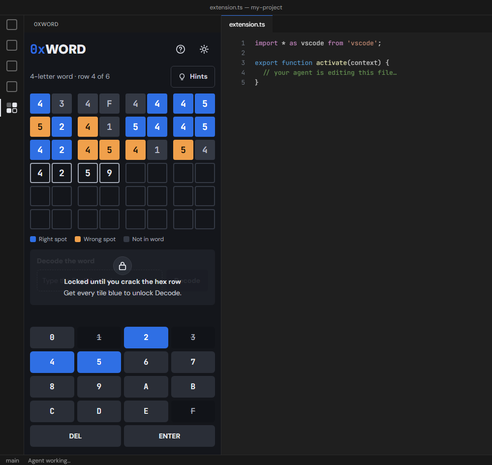
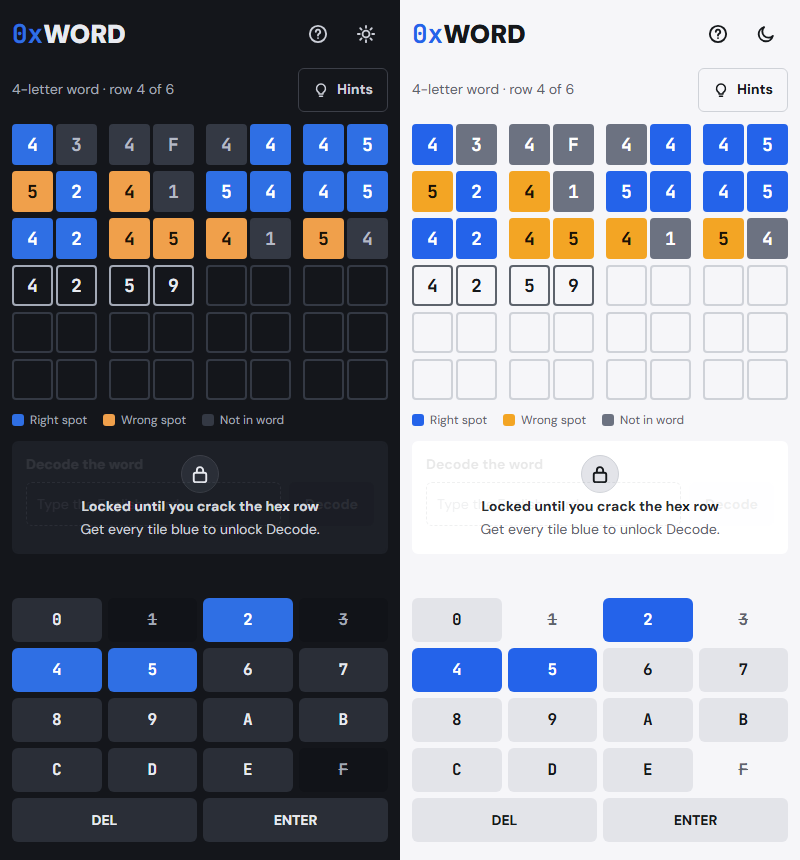
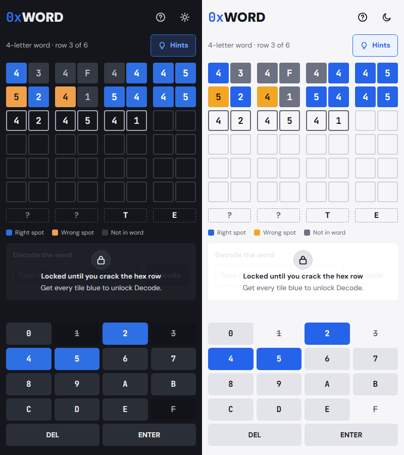
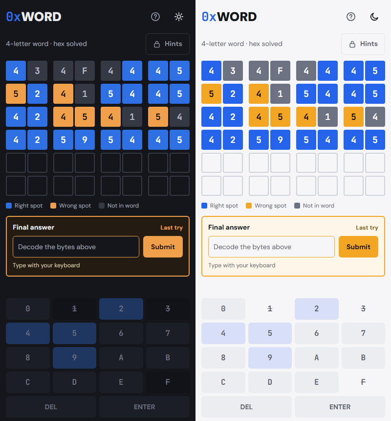
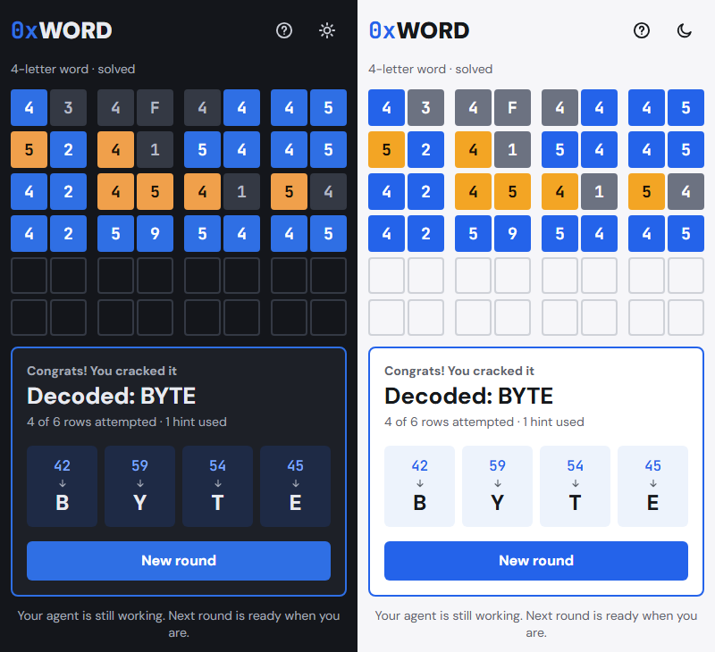
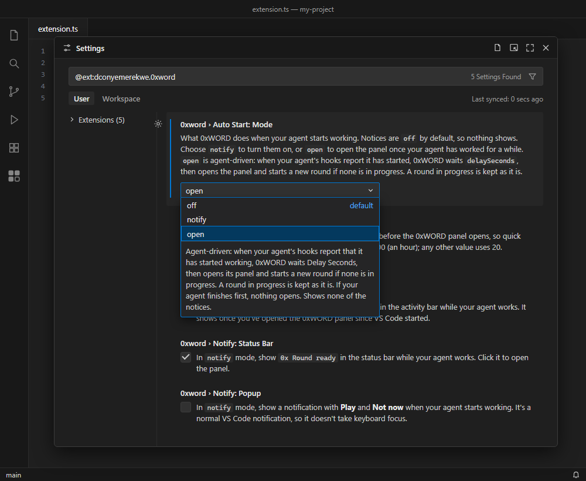

<h1>
  
  
</h1>

A hex word game for VS Code. Guess the hex, decode the word: blue is right spot, orange is wrong spot, grey is not in the word.



## How to play

1. The hidden word has 4 letters, written as ASCII hex: 2 digits per letter.
2. Guess 8 hex digits that spell a real 4-letter word.
3. Each digit turns **blue** right spot, **orange** wrong spot, or **grey** not in the word.
4. Get a row with every tile blue to unlock Decode. Then you get one try at the English word: a wrong word ends the round.
5. You can't repeat a hex guess in the same round. A repeat doesn't use up a row.
6. After 6 rows, the hex keypad locks and Decode unlocks for your one try, even if no row is all blue.
7. Stuck? Turn on **Hints** to see the letters you've fully decoded. It switches off after each hex row and locks once Decode unlocks. Every use is counted in your result.

These are the rules the game shows under its **?** button. Fewer rows means a better score.

**Mid-game.** Type hex on the keypad or your keyboard. Keys you've tried take their best colour, and digits that aren't in the word are struck through. Decode stays locked until you crack the hex row.



**Hints.** The strip under the grid shows the letter of each byte you've got fully right in one row, and `?` for the rest.



**The decode step.** A row with every tile blue locks the hex, and Hints with it. Type the English word in the Final answer box: you get one try.



**The result.** Each byte decodes to its letter, with the rows you used and the hints you turned on. Press **New round** to play again.



### ASCII cheatsheet

`4_` is A–O, `5_` is P–Z. The second digit counts up from there.

| A | B | C | D | E | F | G | H | I | J | K | L | M |
|---|---|---|---|---|---|---|---|---|---|---|---|---|
| `41` | `42` | `43` | `44` | `45` | `46` | `47` | `48` | `49` | `4A` | `4B` | `4C` | `4D` |

| N | O | P | Q | R | S | T | U | V | W | X | Y | Z |
|---|---|---|---|---|---|---|---|---|---|---|---|---|
| `4E` | `4F` | `50` | `51` | `52` | `53` | `54` | `55` | `56` | `57` | `58` | `59` | `5A` |

So `BYTE` is `42 59 54 45`. The game's own cheatsheet is under **?** until you reach the decode step.

## Start a round

Click the 0xWORD icon in the activity bar to open the panel. A round is ready straight away.

Run **0xWORD: New Round** from the Command Palette (<kbd>Ctrl</kbd>+<kbd>Shift</kbd>+<kbd>P</kbd>, or <kbd>Cmd</kbd>+<kbd>Shift</kbd>+<kbd>P</kbd> on macOS) to open the panel and start a fresh round at any time. The round in progress is kept when you hide the panel or reload VS Code.

By default the panel follows your VS Code theme. The sun and moon button cycles through Light, Dark and back to following VS Code.

## Keyboard play

You can play without a mouse:

- Type `0`–`9` and `A`–`F` (either case) to fill the row, <kbd>Backspace</kbd> to delete a digit and <kbd>Enter</kbd> to score the row.
- At the decode step, just start typing: the Final answer box takes the letters. Press <kbd>Enter</kbd> to submit your word.
- <kbd>Tab</kbd> moves through the buttons in the order you see them, and <kbd>Enter</kbd> or <kbd>Space</kbd> presses the focused one. Every control has a visible focus ring.
- <kbd>Esc</kbd> closes How to play.

## Accessibility

- **Screen readers.** Every button has a name, and Hints says whether it's on. Each tile is read out with its digit and mark, scored rows and messages are announced, the hint strip is read as one line, and the result card reads each byte as "42 is B".
- **Reduced motion.** The only animation is a short colour change on the tiles. It's turned off when your system asks for reduced motion, or when VS Code's own **Reduce Motion** setting (`workbench.reduceMotion`) is on.
- **High contrast.** VS Code's high-contrast dark and light themes show the game's dark and light palettes. Text you need to read is checked for at least 4.5:1 contrast in all four kinds of VS Code theme; locked and disabled parts are dimmed on purpose. Absent keys are struck through as well as greyed out, the legend names every colour, and screen readers say each tile's mark.
- **Touch targets.** Every button is at least 44 by 44 pixels.

## Play while your agent works

**Notices are off by default.** To turn them on, open **Settings → Extensions → 0xWORD** and set **Auto Start: Mode** to `notify` or `open`, or add `"0xword.autoStart.mode": "notify"` to your `settings.json`.

0xWORD can show a "Round ready" notice when you send a prompt to your AI agent, and clear it when the agent finishes. In `notify` mode you choose the notices: a badge on the 0xWORD icon, `0x Round ready` in the status bar, or a pop-up. `open` mode is agent-driven: it opens the panel once your agent has worked for a while, and keeps a round in progress as it is. If the agent finishes mid-round, the panel says so and your round stays.



It works through hooks you add to your agent tool. For Claude Code, add this to `~/.claude/settings.json`. If the file already exists, don't paste in a second object: put the two entries inside its `hooks` object, or add a `hooks` key if it has none. If `UserPromptSubmit` or `Stop` is already listed, add the inner `{ "hooks": [ … ] }` entry to that list instead of a second key.

```json
{
  "hooks": {
    "UserPromptSubmit": [
      {
        "hooks": [
          { "type": "command", "command": "code --open-url \"vscode://dconyemerekwe.0xword/agent-started\"" }
        ]
      }
    ],
    "Stop": [
      {
        "hooks": [
          { "type": "command", "command": "code --open-url \"vscode://dconyemerekwe.0xword/agent-finished\"" }
        ]
      }
    ]
  }
}
```

The first time a hook runs, VS Code asks **Allow an extension to open this URI?** Tick **Don't ask again** and allow it, once. For GitHub Copilot, Copilot CLI, Cursor and Codex, and the details, see the setup guide, [docs/agent-integration.md](docs/agent-integration.md). The hooks pass nothing from your prompts, and 0xWORD never edits your agent tool's config.

## No telemetry

0xWORD collects nothing and sends nothing. It makes no network requests and never reads or writes your files. The round in progress stays on your machine in VS Code's own storage, and so do a few counts (rounds played and solved, average rows, how often you used hints), kept for a stats screen planned for a later version. See [SECURITY.md](SECURITY.md) for the full list of rules it's built to.

## Development

Requires Node 24 or newer.

```sh
npm ci            # install the pinned dev tools (install scripts are disabled in .npmrc)
npm run build     # bundle the extension into dist/ and the webview into media/dist/
npm run typecheck # type-check without emitting
npm test          # run unit tests with node:test
npm run package   # build a .vsix with vsce
```

To try it, open this folder in VS Code and press **F5**. That builds the extension and opens an Extension Development Host window with it loaded. Click the 0xWORD icon in the activity bar to open the panel, or run **0xWORD: New Round** from the Command Palette to start a round.

## Licence

[MIT](LICENSE)
