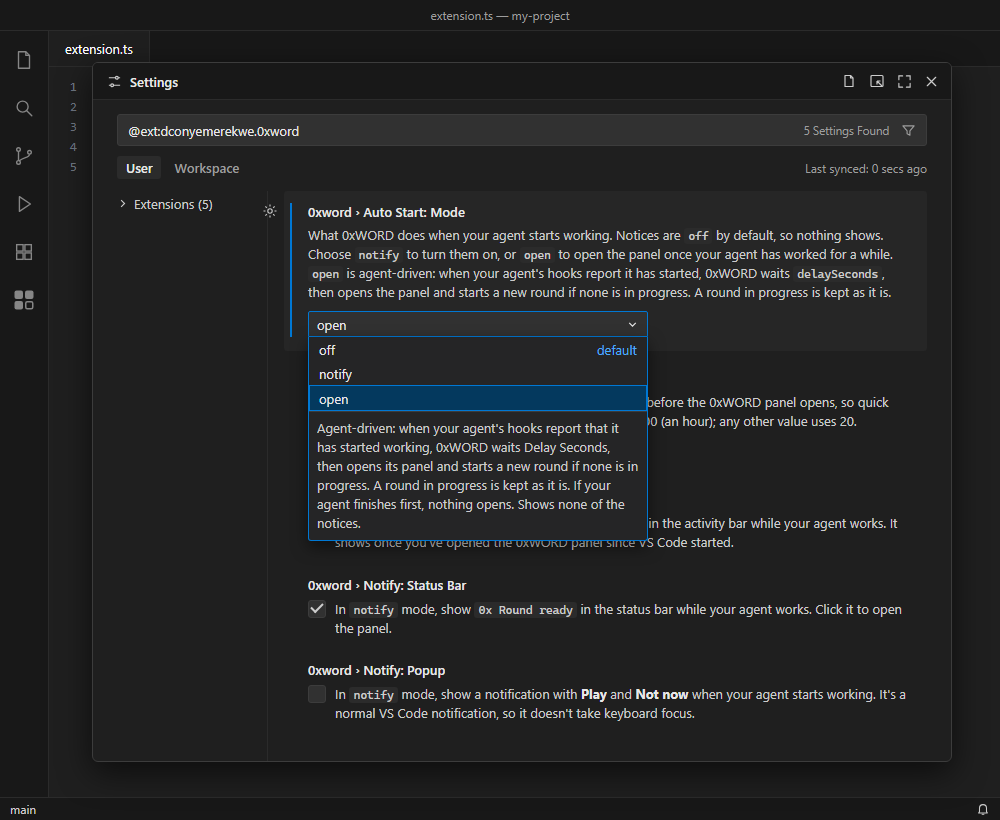
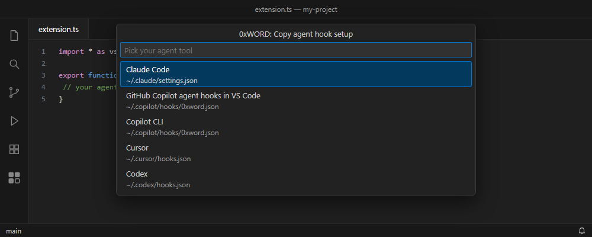

# Play while your agent works

> **Notices are off by default.** Until you turn them on, 0xWORD shows nothing when your agent starts or finishes, even with the hooks below set up. To turn them on, open **Settings → Extensions → 0xWORD** and set **Auto Start: Mode** to `notify` or `open`, or add `"0xword.autoStart.mode": "notify"` to your `settings.json`.

0xWORD can tell you a round is ready while your AI agent is working, and get out of the way when it's done. It works with any agent tool that can run a command when you send a prompt and when the agent finishes. This guide covers **Claude Code, GitHub Copilot (agent hooks in VS Code, and Copilot CLI), Cursor and Codex**.

To set it up:

1. Turn notices on (see [Settings](#settings)).
2. Add the hooks for your agent tool (see [Setting up your agent tool](#setting-up-your-agent-tool)).
3. Send your agent a prompt. The first time, VS Code asks **Allow an extension to open this URI?** Tick **Don't ask again** and allow it, once. Until you tick it, VS Code asks for every link.

## How it works

```
you send a prompt ──► the tool's hook runs ──► code --open-url "vscode://dconyemerekwe.0xword/agent-started"
                                                        │
                                                        ▼
                                          0xWORD shows "Round ready"
                                                        │
the agent finishes ──► the tool's hook runs ──► code --open-url "vscode://dconyemerekwe.0xword/agent-finished"
                                                        │
                                                        ▼
                                  the notice goes away; a round in progress stays
```

- **Two signals, and nothing else.** The hooks open one of two fixed links: `vscode://dconyemerekwe.0xword/agent-started` or `vscode://dconyemerekwe.0xword/agent-finished`. `dconyemerekwe.0xword` is 0xWORD's extension ID. 0xWORD ignores any other link, and any link with extra parts or arguments.
- **No data is passed.** Hooks are given your prompt by the agent tool, but these hook commands never read it, and the links carry nothing from it. 0xWORD never sees what you asked or what the agent did.
- **You set up the hooks.** 0xWORD never edits your agent tool's config files. You add the hook yourself, using the snippets below.
- **Without hooks, nothing changes.** You can always start a round yourself from the panel or with **0xWORD: New Round**.

## Settings

Find these under **Settings → Extensions → 0xWORD**. VS Code saves them for you, so a choice lasts until you change it, across rounds, restarts and updates. You can also set them per workspace, for example off in one project and on in another.



| Setting | Values | Default | What it does |
|---|---|---|---|
| `0xword.autoStart.mode` | `off`, `notify`, `open` | `off` | What happens when your agent starts working. `off` shows nothing, so a fresh install stays quiet, and you can pause notices without removing your hooks. Choose `notify` to turn them on. `notify` shows the notices switched on below. `open` is agent-driven: it opens the 0xWORD panel once your agent's hooks have reported it working for `delaySeconds`, and shows none of the notices. |
| `0xword.notify.badge` | on / off | on | In `notify` mode, a badge on the 0xWORD icon in the activity bar. It shows once you've opened the 0xWORD panel since VS Code started. |
| `0xword.notify.statusBar` | on / off | on | In `notify` mode, `0x Round ready` in the status bar. Click it to open the panel. |
| `0xword.notify.popup` | on / off | off | In `notify` mode, a notification in the corner with **Play** and **Not now**, once each time your agent starts. **Play** opens the panel without touching your round. |
| `0xword.autoStart.delaySeconds` | 0 to 3600 seconds | 20 | In `open` mode only: how long the agent must still be working before the panel opens. Short prompts that finish sooner never open it. `0` opens it as soon as you send a prompt. |

To turn notices on in `settings.json` instead (Command Palette → **Preferences: Open User Settings (JSON)**), add:

```json
{
  "0xword.autoStart.mode": "notify"
}
```

A change applies straight away, even while a notice is showing: turning the status bar off hides it, and choosing `off` clears every notice. Leaving `open` mode while 0xWORD is waiting to open the panel cancels the wait. Choosing `open` while your agent is already working starts nothing until your next prompt, and a new `delaySeconds` applies from your next prompt too. A value in a workspace's settings overrides your user setting. A value that isn't valid, for example a word other than `off`, `notify` or `open` typed into `settings.json`, or a delay that's negative, over 3600 or not a number, counts as that setting's default.

### What you'll see

- **In `off` mode, the default,** nothing shows.
- **In `notify` mode,** the notices you've turned on appear as soon as you send a prompt, and disappear when the agent finishes. Click one to open the panel. Whether VS Code comes forward depends on where your agent runs: a link opened from VS Code's own terminal, with VS Code in front, didn't move keyboard focus, but from a terminal outside VS Code, VS Code comes to the front. Hooks run by VS Code itself, as with Copilot's agent or an agent in an editor panel, haven't been tested yet. The pop-up itself is a normal VS Code notification and doesn't take keyboard focus. VS Code can't close a pop-up for 0xWORD, so a pop-up still showing when the agent finishes stays until you close it.
- **In `open` mode,** which is agent-driven, 0xWORD opens the panel once your agent's hooks have reported it working for `delaySeconds`, at most once per prompt. If the agent finishes sooner, nothing happens. A round in progress is kept as you left it, apart from a "finished" message from the last prompt, which is cleared. If the last round is over (the result card is showing), or you haven't played one yet, a new round starts. The panel is meant to open without taking keyboard focus, so typing elsewhere keeps going there, and not to move focus to its decode box or **New round** button until the panel gets keyboard focus (for example, when you click into it). This hasn't been tested yet. The one exception is when VS Code hasn't loaded the 0xWORD panel yet, such as the first time since VS Code started: VS Code has no way for an extension to open a view it hasn't loaded without focusing it, so then the panel takes keyboard focus. A link from a terminal outside VS Code also brings VS Code to the front as soon as you send the prompt, before the delay. No badge, status-bar item or pop-up shows in this mode.
- **If you interrupt the agent,** some tools don't run their "finished" hook. Claude Code's docs say its `Stop` hook doesn't run when you interrupt Claude, and Codex has a separate `Interrupt` event. 0xWORD then still counts the agent as working, so your next prompt counts as the same run: in `open` mode the panel won't open for that prompt (and in `notify` mode no new pop-up shows). That prompt's own finish resets it, and the prompt after works as usual.
- **A round in progress is never interrupted.** In `notify` and `open` mode, if the agent finishes mid-round while the panel is showing, the line under the grid says "Your agent has finished. Your round is still here." and you can finish or leave the round. It goes away when you next use the keypad, score a row or submit your word, or when your agent starts working again. Typing in the decode box doesn't clear it. If the panel was hidden, or the result card is showing, this message isn't shown.
- **Under the result card,** in `notify` and `open` mode, a line says whether your agent is still working or has finished, and changes as soon as it does. In `off` mode, or before your agent has sent anything since VS Code started or the window was reloaded, there's no line.
- **An unfinished round carries over.** Play a row or two while one prompt runs and pick it up again on the next.

## Setting up your agent tool

Each hook runs one command when you send a prompt:

```sh
code --open-url "vscode://dconyemerekwe.0xword/agent-started"
```

and one when the agent finishes:

```sh
code --open-url "vscode://dconyemerekwe.0xword/agent-finished"
```

`code` is VS Code's command-line launcher. The Windows and Linux installers usually add it to your PATH. On macOS, open VS Code's Command Palette and run **Shell Command: Install 'code' command in PATH**.

The commands print nothing. Keep it that way: some tools add a hook's output to the conversation or read it as an answer. Don't add `echo` or other output to them.

Agent tools change their hook systems often, and several are still in preview. Each section below says when it was last checked against the tool's own docs, and marks anything not yet tested.

You can also copy your tool's setup with **0xWORD: Copy agent hook setup**.



### Claude Code

Checked 2026-11-10 against [Claude Code's hooks reference](https://code.claude.com/docs/en/hooks).

Add this to `~/.claude/settings.json`, your user settings, so it works in every project. If the file already exists, don't paste in a second object: put the `UserPromptSubmit` and `Stop` entries inside its `hooks` object, or add a `hooks` key if it has none. If the file already has a `UserPromptSubmit` or `Stop` list, add the inner `{ "hooks": [ … ] }` entry to that existing list instead of adding a second key: a second key with the same name replaces the first, so one of the hooks would be lost.

```json
{
  "hooks": {
    "UserPromptSubmit": [
      {
        "hooks": [
          { "type": "command", "command": "code --open-url \"vscode://dconyemerekwe.0xword/agent-started\"" }
        ]
      }
    ],
    "Stop": [
      {
        "hooks": [
          { "type": "command", "command": "code --open-url \"vscode://dconyemerekwe.0xword/agent-finished\"" }
        ]
      }
    ]
  }
}
```

- `UserPromptSubmit` runs when you send a prompt, and `Stop` runs when Claude finishes its reply. Neither needs a `matcher`.
- On `UserPromptSubmit`, anything the command prints is added to Claude's context, which is why it must print nothing. Exit code 0 with no output is success.
- `Stop` doesn't run when you interrupt Claude (see [What you'll see](#what-youll-see)).
- Each hook can take an optional `"shell"`: `"bash"` or `"powershell"`. The default is bash, or PowerShell on Windows when Git Bash isn't installed. The command works in both.
- Run `/hooks` in Claude Code to check they're loaded.
- **Use your user settings, not a project's.** Claude Code also reads `.claude/settings.json` (one project, shared with everyone who clones it) and `.claude/settings.local.json` (one project, just you). GitHub Copilot's agent in VS Code and Copilot CLI read a repo's `.claude/settings.json` too, so a hook placed there could also run from those tools, and for everyone who clones the repo.

### GitHub Copilot agent hooks in VS Code

Checked 2026-11-10 against [VS Code's agent hooks guide](https://code.visualstudio.com/docs/copilot/customization/hooks). Agent hooks are in preview, and organisations can turn them off.

Save this as a `.json` file in `~/.copilot/hooks/` (or `$COPILOT_HOME/hooks/`), for example `~/.copilot/hooks/0xword.json`. A repo's `.github/hooks/` folder also works, but would share the hook with everyone who clones the repo.

```json
{
  "version": 1,
  "hooks": {
    "userPromptSubmitted": [
      { "type": "command", "command": "code --open-url \"vscode://dconyemerekwe.0xword/agent-started\"", "timeoutSec": 10 }
    ],
    "agentStop": [
      { "type": "command", "command": "code --open-url \"vscode://dconyemerekwe.0xword/agent-finished\"", "timeoutSec": 10 }
    ]
  }
}
```

- Use the **Copilot** session target. The older `chat.useHooks` settings don't configure these hooks.
- `userPromptSubmitted` runs when you send a prompt, and its output is ignored. `agentStop` runs when the agent finishes.
- An entry can also give separate `bash` and `powershell` commands. The one `command` above works in both.
- Not documented on that page: exit codes, and what happens to `agentStop`'s output. The command prints nothing and exits 0, so neither should matter.

### Copilot CLI

Checked 2026-11-10 against [GitHub's Copilot CLI hooks reference](https://docs.github.com/en/copilot/reference/copilot-cli-reference/cli-hooks-reference).

Copilot CLI uses the same file format, in the same places: any `.json` file in `~/.copilot/hooks/` (on Windows, `%USERPROFILE%\.copilot\hooks\`), or a repo's `.github/hooks/`. The file from the section above works for Copilot CLI too, so if you've saved it there you're done.

```json
{
  "version": 1,
  "hooks": {
    "userPromptSubmitted": [
      { "type": "command", "command": "code --open-url \"vscode://dconyemerekwe.0xword/agent-started\"", "timeoutSec": 10 }
    ],
    "agentStop": [
      { "type": "command", "command": "code --open-url \"vscode://dconyemerekwe.0xword/agent-finished\"", "timeoutSec": 10 }
    ]
  }
}
```

- `userPromptSubmitted` runs when you send a prompt. `agentStop` runs when the main agent finishes a turn, so the notice clears after each reply. (`sessionEnd`, which runs only when the whole session ends, isn't needed.)
- `command` is used for both `bash` and `powershell` when those aren't given. `timeoutSec` defaults to 30.
- Empty output counts as no output. A non-zero exit code is logged and skipped. A sandbox may apply to hook commands.
- Copilot CLI runs in a terminal. From a terminal outside VS Code, the link brings VS Code to the front (see [What you'll see](#what-youll-see)).

### Cursor

Checked 2026-11-10 against [Cursor's hooks docs](https://cursor.com/docs/agent/hooks).

> **Not yet tested; check before relying on it.** Cursor's docs don't say which link scheme Cursor registers, or whether its `cursor` launcher supports `--open-url`. The snippet below assumes `cursor://` and `cursor --open-url`, as VS Code uses `vscode://` and `code --open-url`. Try both commands in a terminal first: with notices on, `0x Round ready` should appear in Cursor's status bar, then go away.

Add this to `~/.cursor/hooks.json` (your user hooks; their commands run from `~/.cursor/`). A project's `.cursor/hooks.json` also works, but only in a trusted workspace. If the file already exists, keep its one `"version"` and put the two entries under its existing `hooks`. If it already has a `beforeSubmitPrompt` or `stop` list, add the entry to that list instead of a second key.

```json
{
  "version": 1,
  "hooks": {
    "beforeSubmitPrompt": [
      { "command": "cursor --open-url \"cursor://dconyemerekwe.0xword/agent-started\"" }
    ],
    "stop": [
      { "command": "cursor --open-url \"cursor://dconyemerekwe.0xword/agent-finished\"" }
    ]
  }
}
```

- `beforeSubmitPrompt` runs when you send a prompt, and `stop` when the agent finishes. `"version": 1` is required.
- On Windows, Cursor's desktop app runs hook commands through PowerShell.
- Exit code 0 is success, 2 blocks, and any other code fails open.
- `beforeSubmitPrompt` can block a prompt. Cursor's docs don't say whether a hook that prints nothing lets the prompt through. Their own example hook prints nothing and exits 0, so it's expected to, but that isn't confirmed.

### Codex

Checked 2026-11-10 against [Codex's hooks docs](https://learn.chatgpt.com/docs/hooks).

Codex hooks are on by default (`[features] hooks = false` in `config.toml` turns them off). Add this to `~/.codex/hooks.json`. If the file already exists, put the two entries under its existing `hooks`. If it already has a `UserPromptSubmit` or `Stop` list, add the inner `{ "hooks": [ … ] }` entry to that list instead of a second key. A repo's `.codex/` folder also works, but is loaded only when the repo is trusted. Codex asks you to review and trust new hooks before they run.

```json
{
  "hooks": {
    "UserPromptSubmit": [
      {
        "hooks": [
          { "type": "command", "command": "code --open-url \"vscode://dconyemerekwe.0xword/agent-started\"" }
        ]
      }
    ],
    "Stop": [
      {
        "hooks": [
          { "type": "command", "command": "code --open-url \"vscode://dconyemerekwe.0xword/agent-finished\"" }
        ]
      }
    ]
  }
}
```

- `UserPromptSubmit` runs when you send a prompt, and anything it prints becomes context, which is why it must print nothing. `Stop` runs when the agent finishes.
- On `Stop`, exit code 0 with no output is expected to be fine, but Codex's docs don't say so clearly.
- Interrupting the agent fires Codex's separate `Interrupt` event, not `Stop`.
- Hooks can also go in `~/.codex/config.toml`. Use `hooks.json`: the TOML form isn't covered here.
- Codex's older `notify` setting runs a command only when the agent finishes, so it can send `agent-finished` but never `agent-started`. Use hooks instead.

## Known limits

- **Copilot CLI** sends both signals with `userPromptSubmitted` and `agentStop`. `sessionEnd`, its other "finished" event, fires only when the whole session ends.
- **Codex** sends both signals with hooks. Its older `notify` setting can only send `agent-finished`.
- **Cursor's** link scheme and launcher aren't tested yet (see [Cursor](#cursor)).
- **Interrupting the agent** may skip the "finished" hook (see [What you'll see](#what-youll-see)).
- **From a terminal outside VS Code,** each link brings VS Code to the front.
- **Several VS Code windows.** Which window gets the link when several are open hasn't been tested yet.
- **Only tried on Windows.** How VS Code handles these links (the confirmation, coming to the front, keyboard focus) has only been tried on Windows. Hooks that your agent tool runs in the background haven't been tested yet.
- **Other editors.** The snippets cover VS Code (stable) and Cursor (not yet tested). VS Code Insiders, VSCodium and other editors use their own launcher and link scheme (for example `code-insiders` with `vscode-insiders`, or `codium` with `vscodium`), and haven't been tested. A snippet that uses `code` sends the link to stable VS Code, even if you play in another editor.

## Privacy and security

- **No telemetry.** 0xWORD still collects nothing and sends nothing. The hooks only open a link on your own machine.
- **Your prompts stay with your agent tool.** The hook commands never read them, and the links never carry them.
- **Only two fixed links do anything.** Any other link to 0xWORD is ignored. Because any program or web page on your machine can open a `vscode://` link, the worst a stray link can do is show or clear a "Round ready" notice, open the 0xWORD panel in `open` mode (never replacing a round in progress, and, though this hasn't been tested yet, without taking keyboard focus, except when VS Code hasn't loaded the 0xWORD panel yet, such as the first time since VS Code started), and bring VS Code to the front.
- **Your config files stay yours.** 0xWORD never writes to your agent tool's settings. You add and remove the hooks.
